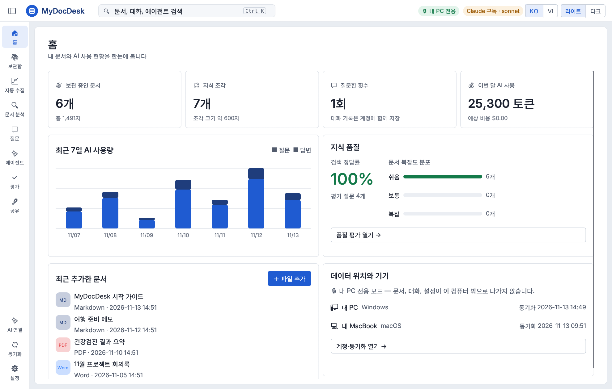
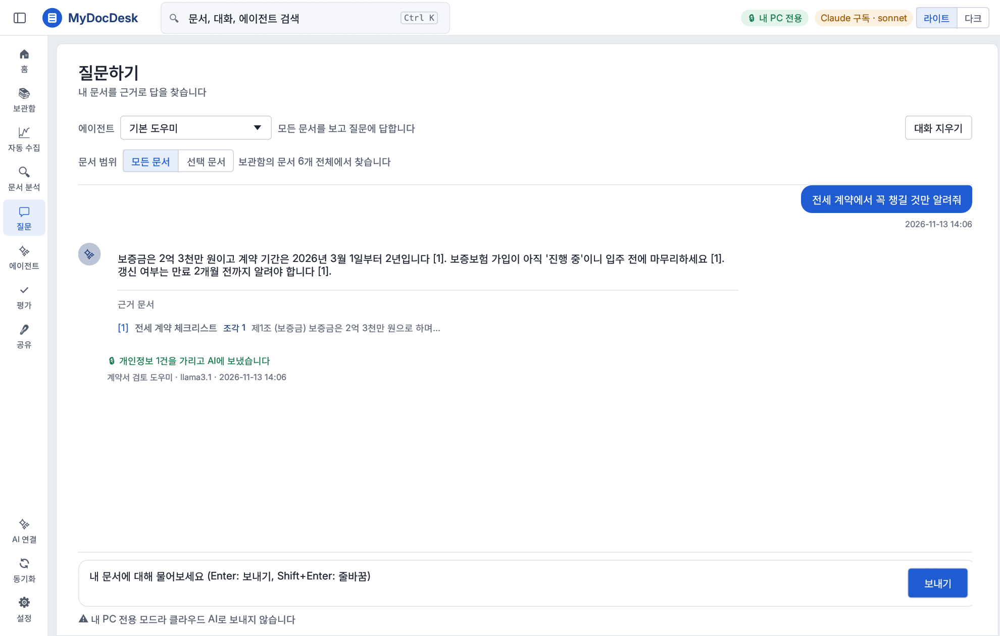
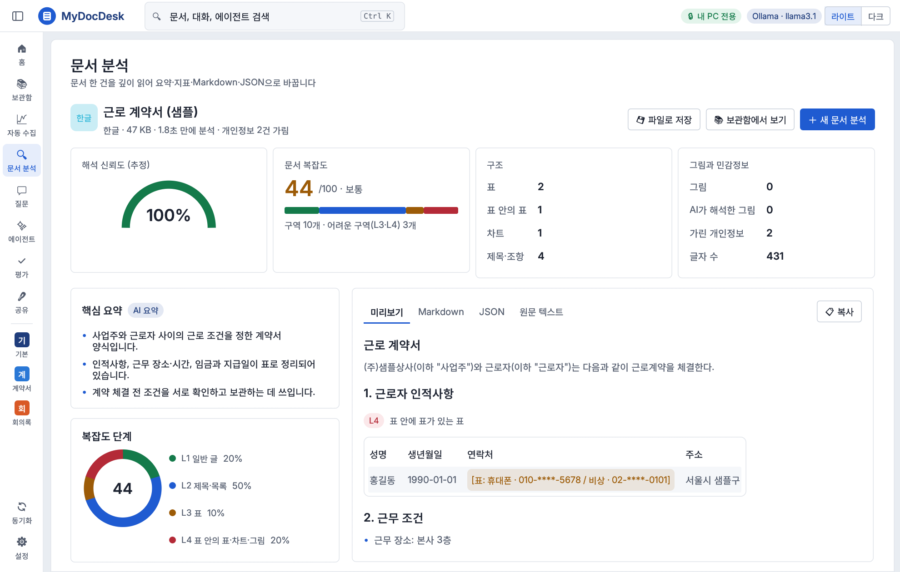
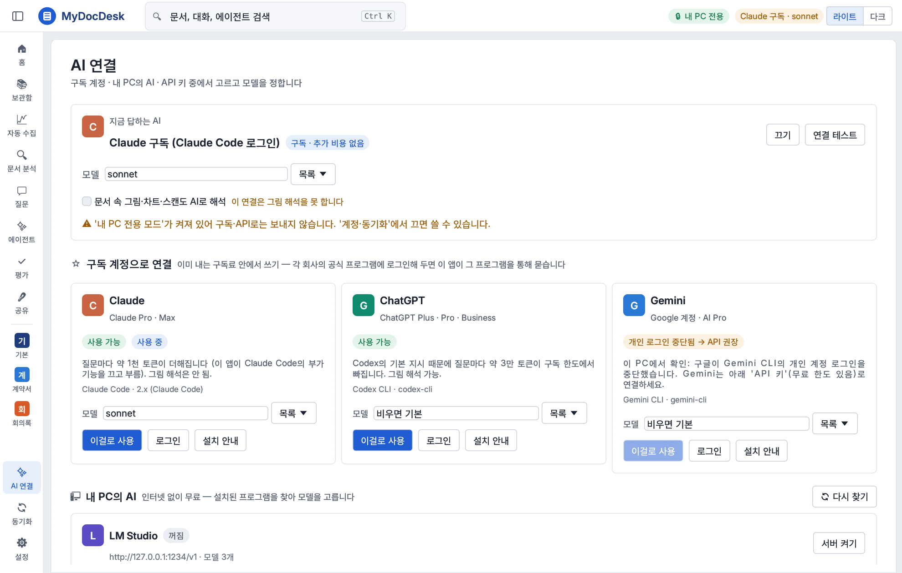
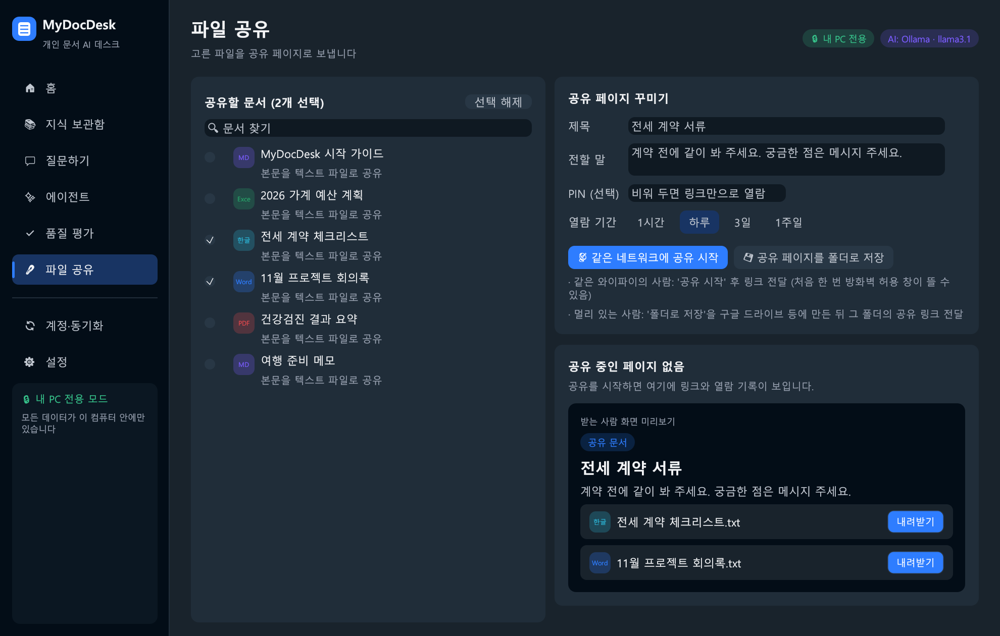

# MyDocDesk

**혼자 쓰는 문서 AI 데스크톱 앱** — 흩어진 문서를 모아 내 PC 안에서 검색하고, AI에게 내 문서를 근거로 질문합니다.
Windows·macOS 설치형이며, 기본은 **내 PC에서만** 동작합니다.



## 무엇을 하나

| 화면 | 하는 일 |
|---|---|
| 지식 보관함 | 파일을 끌어다 놓거나 폴더째 가져와 AI가 찾을 수 있는 텍스트로 바꿔 둡니다. 태그·메모 지원 |
| 자동 수집 | 연결한 폴더에서 새로 생기거나 바뀐 문서만 골라 반영합니다 |
| 문서 분석 | 문서 한 건을 깊이 읽어 요약·구조·신뢰도를 보여 주고 Markdown·JSON으로 내보냅니다 |
| 질문하기 | 내 문서에서 근거를 찾아 답합니다. 답에 근거 번호가 붙고, 특정 문서만 골라 물을 수도 있습니다 |
| 에이전트 | 자주 하는 일을 도우미로 저장합니다 (답변 형식, 태그 범위, 개인정보 가림, 근거 확인) |
| 품질 평가 | 질문 세트로 검색·답변 품질을 점검합니다 |
| 파일 공유 | 고른 파일을 공유 페이지로 보냅니다 (폴더로 내보내기 / 같은 네트워크에 PIN·만료시간이 있는 링크) |
| 계정·동기화 | 같은 계정의 PC·Mac끼리 데이터를 맞춥니다 |

화면 언어는 **한국어 / 베트남어**, 테마는 라이트 / 다크를 지원합니다.

### 읽을 수 있는 파일

- 문서: PDF, Word(`docx`), Excel(`xlsx`), PowerPoint(`pptx`), 한글(`hwp`, `hwpx`), `odt`, `rtf`, HTML
- 텍스트: `txt`, `md`, `csv`, `tsv`, `json`, `xml`, `yaml`, 소스 코드 등
- 그림: `png`, `jpg`, `webp` — 그림 해석을 켜면 AI가 그림·차트·스캔 내용을 글로 바꿔 함께 저장합니다

표 안의 표, 차트 숫자도 보존합니다. 구형 바이너리 `hwp` 도 별도 프로그램 없이 읽습니다.

## AI 연결

AI 없이도 문서 보관·검색은 됩니다. 답변을 만들 때만 아래 중 하나를 연결합니다.

| 방식 | 예 | 문서가 PC 밖으로 나가나 |
|---|---|---|
| 내 PC의 AI | Ollama, LM Studio, 기타 OpenAI 호환 로컬 서버 | 아니요 |
| 구독 계정 | Claude Code(`claude`), Codex(`codex`), Gemini CLI(`gemini`) — 각 사 공식 프로그램에 로그인해 두면 그 구독으로 답합니다 | 예 |
| API 키 | OpenAI, Anthropic, Google Gemini | 예 |

- **'내 PC 전용 모드'가 기본으로 켜져 있습니다.** 켜져 있는 동안은 구독·API로 아무것도 보내지 않고 동기화도 하지 않습니다.
- 구독 방식은 공식 프로그램을 그대로 실행할 뿐, 로그인 정보를 읽거나 복사하지 않습니다.
- Gemini CLI는 구글이 개인 계정 로그인을 막는 경우가 있습니다. 그때는 Google Gemini API 키(AI Studio에서 무료 한도 발급)로 연결하세요.
- API 키는 이 기기의 설정 파일에만 저장됩니다.

## 동기화와 공유

- **동기화**: 별도 서버가 없습니다. Google Drive·OneDrive·Dropbox·iCloud 같은 클라우드 폴더를 하나 고르면,
  그 안에 계정 이름+암호로 **암호화한 파일**(XChaCha20-Poly1305)을 두고 기기끼리 맞춥니다. 클라우드 업체는 내용을 볼 수 없습니다.
- **공유**: 동기화와는 별개입니다. 고른 파일만 공유 페이지로 만들어 폴더로 내보내거나(USB·클라우드에 올리기),
  같은 네트워크의 다른 기기에 비밀 링크로 바로 보여 줍니다.

## 빌드와 실행

[Rust](https://rustup.rs) (stable) 가 필요합니다. 소스는 `app/` 폴더에 있습니다.

```bash
cd app
cargo run --release          # 실행
cargo test                   # 테스트
cargo bundle --release       # 설치 파일 만들기 (cargo-bundle 필요: macOS .app / Windows .msi)
```

한글 글꼴은 시스템에 설치된 것(Noto Sans KR → 맑은 고딕 → Apple SD Gothic Neo 순)을 씁니다.

### 화면 캡처 모드

실제 데이터를 건드리지 않고 데모 데이터로 화면을 찍은 뒤 스스로 종료합니다.

```bash
./target/release/mydocdesk --screenshot shots/home.png --page home
MDD_THEME=dark MDD_LANG=vi ./target/release/mydocdesk --screenshot shots/vi-home.png --page home
```

`--page`: `home` `library` `pipeline` `analyze` `ask` `agents` `eval` `share` `ai` `sync` `settings`

## 데이터 위치

문서 목록·설정·원본 파일 사본은 이 기기에만 저장됩니다.

- Windows: `%APPDATA%\MyDocDesk\`
- macOS: `~/Library/Application Support/MyDocDesk/`

## 화면

| 질문하기 | 문서 분석 |
|---|---|
|  |  |
| **AI 연결** | **파일 공유** |
|  |  |

## 라이선스

[Apache License 2.0](LICENSE)
